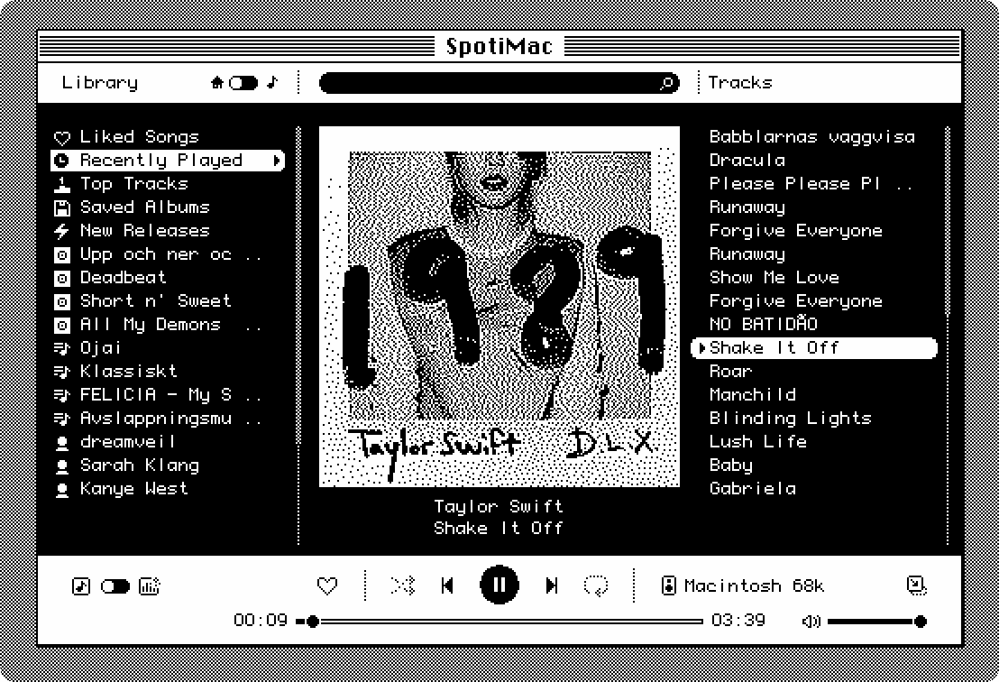
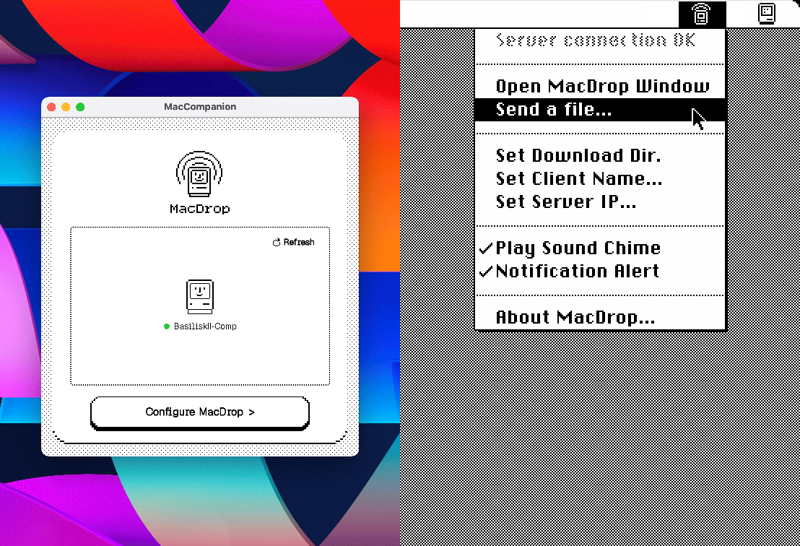
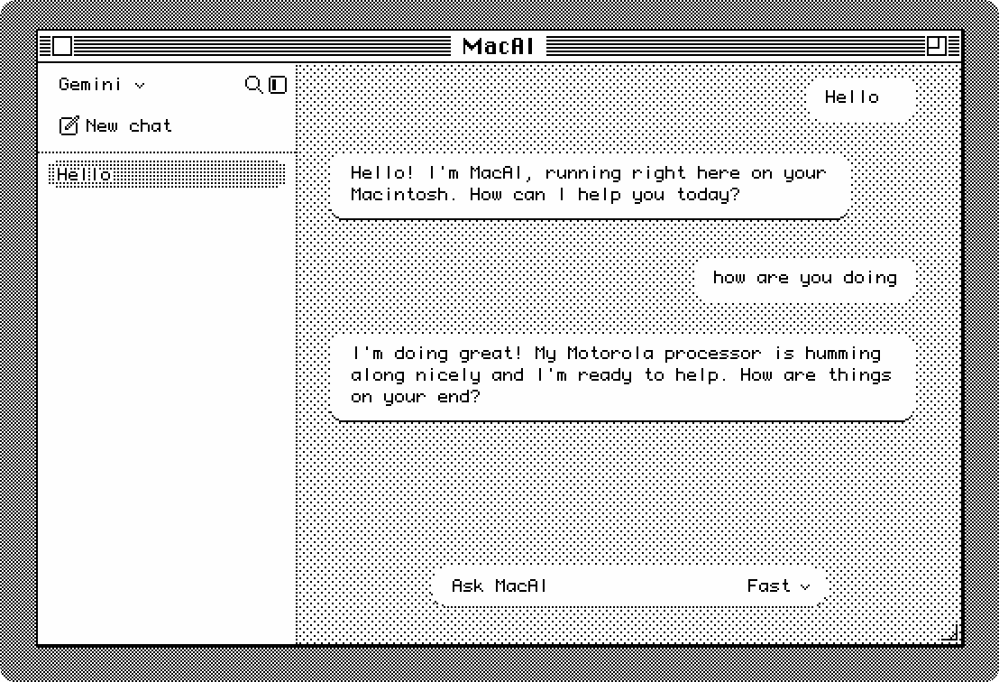

# MacCompanion

Classic Macs are timeless, but the modern web left them behind around 1998. **MacCompanion** is a lightweight bridge server and a selection of client apps that lets your vintage 68k Macintosh party like it's 1984.

**Requirements:**
- Any always-on computer, NAS, Raspberry Pi or similar on your local network capable of running **Docker** with an internet connection.

---

## Client Apps

### SpotiMac



Spotify for your 68k Mac. **Supports local playback** and multitasking with a mini player, all so you can get that real work done and delivered to your favorite tunes. Throwing a party? There might be a nice feature for that built in too.

**Requirements:**
- **Account:** Spotify Premium + a free Spotify Developer Client ID.
- **OS:** System 7.0 - Mac OS 9.2.2 (System 7.1–7.5.5 recommended).
- **CPU:** 68000 minimum (Macintosh Plus, SE, Classic and up); 68020+ recommended for real-time audio visualizers.
- **Sound:** Sound Manager 3.0 (built into System 7.5+; available as an Apple extension for System 7.0/7.1).
- **Networking:** MacTCP 2.0.6+ or Open Transport with an active local network connection.

---

### MacDrop



Like Airdrop, if it was invented in the 1990's. Biderectional file transfers with device auto discovery. Ever wanted to drop files from your phone straight to your 68k Mac? Well, now you can (Yes, it also works from other devices :).

**Requirements:**
- **OS:** System 7.0 – Mac OS 9.2.2 (System 7.1–7.5.5 recommended).
- **CPU:** 68000 minimum (Macintosh Plus, SE, Classic, and up).
- **RAM:** 512 KB minimum / 1024 KB preferred.
- **Networking:** MacTCP 2.0.6+ or Open Transport (zero-configuration reverse-push channel & UDP auto-discovery).

---

### MacAI



AI for your vintage 68k Mac. Converse with Gemini, ChatGPT, Claude, and Groq right from within System 7. Featuring image generation, bi-directional voice, and an ominous sentient mainframe.

**Requirements:**
- **Account:** Free or paid API key for Google Gemini, Groq, OpenAI, or Anthropic Claude.
- **OS:** System 7.0 – Mac OS 9.2.2 (System 7.1–7.5.5 recommended).
- **CPU:** 68000 minimum; 68020+ recommended for faster 1-bit image dithering.
- **Networking:** MacTCP 2.0.6+ or Open Transport with an active local network connection.

---

## Quick Start

1. **Install/start the MacCompanion server:**

Docker Compose (recommended):

```yaml
services:
  maccompanion:
    image: ghcr.io/aeroform-se/maccompanion:latest
    container_name: maccompanion
    network_mode: host #Enables UDP discovery, you may use the ports below instead
    environment:
      - TZ=Europe/Stockholm #Enter your timezone, see:https://en.wikipedia.org/wiki/List_of_tz_database_time_zones
    volumes:
      - ./maccompanion/data:/app/data #enter the path where you wish to store MacCompanion data
    restart: unless-stopped
    # Uncomment if you won't use host mode
    # 6800      Web GUI & HTTP API
    # 6801/udp  Local LAN Discovery
    # 6802      Audio Streaming
    # 6803      File transfers
```

Start it:

```bash
docker compose up -d
```

2. **Configure your settings:** Open `http://<your-server-ip>:6800` in a modern browser to configure your client services.

3. **Compute!** Simply drag, drop and launch any client app you wish to use from the .dsk release files.

---

## Support

**Do you love MacCompanion?**
Support this project by [Buying me a coffe](https://buymeacoffee.com/MacCompanion)

---

## Credits & Open Source Acknowledgments

This project is built with the help of the following open-source projects and libraries:

- **[Express](https://expressjs.com/)** — Fast, unopinionated, minimalist web framework for Node.js ([MIT License](https://github.com/expressjs/express/blob/master/LICENSE))
- **[Sharp](https://sharp.pixelplumbing.com/)** — High-performance Node.js image processing powered by [libvips](https://www.libvips.org/) ([Apache-2.0 License](https://github.com/lovell/sharp/blob/main/LICENSE))
- **[librespot](https://github.com/librespot-org/librespot)** — Open-source Spotify Connect client library ([MIT License](https://github.com/librespot-org/librespot/blob/dev/LICENSE))
- **[FFmpeg](https://ffmpeg.org/)** — Multimedia framework used for real-time 8-bit PCM downsampling and DSP voice filtering ([LGPLv2.1+ / GPLv2+](https://ffmpeg.org/legal.html))
- **[eSpeak NG](https://github.com/espeak-ng/espeak-ng)** — Open-source compact formant text-to-speech synthesizer powering local server-side TTS and synthetic computer voices ([GPLv3 License](https://github.com/espeak-ng/espeak-ng/blob/master/COPYING))
- **[SoX (Sound eXchange)](https://sourceforge.net/projects/sox/)** — Open-source command-line audio processing utility used for GLaDOS chorus, overdrive, and reverb voice synthesis ([GPLv2+ / LGPLv2.1+ License](https://sourceforge.net/p/sox/code/ci/master/tree/COPYING))
- **[Retro68](https://github.com/autc04/Retro68)** by Wolfgang Thaller — GCC-based cross-compiler toolchain targeting 68k and PowerPC Macintosh systems ([GPLv3 with GCC Runtime Library Exception](https://github.com/autc04/Retro68/blob/master/COPYING))

A Special thanks to  **[Antscode](https://github.com/antscode)** who inspired this project by writing the first Spotify 68k client back in 2018.